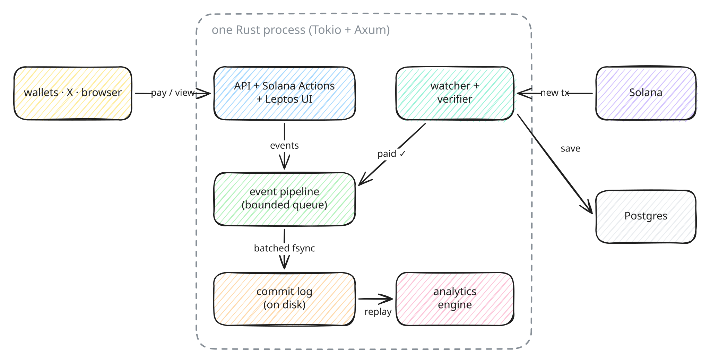

# Blinker ⚡

**Shareable Solana payment links ("blinks"), written in Rust from the wire format to the pixels.**

**Live (Solana devnet): [blinker.onrender.com](https://blinker.onrender.com)** · [system telemetry](https://blinker.onrender.com/system) · [`/metrics`](https://blinker.onrender.com/metrics)

Create a blink — title, image, preset amounts, recipient, in SOL or any SPL token — pay a 0.001 SOL
activation fee, and share the link. Wallets and X render it as one-tap payment buttons (it's a
spec-compliant [Solana Action](https://solana.com/docs/advanced/actions)), and the Blinker page doubles as a standalone checkout.
Every view, transaction and confirmed payment streams through an event pipeline into live analytics.

| | |
|---|---|
| **Backend** | Axum + Tokio, Postgres (sqlx) |
| **Frontend** | Leptos (SSR + WASM hydration), hand-written CSS effects inspired by Aceternity UI |
| **Solana** | hand-rolled wire format: tx encoding/decoding, PDAs/ATAs, instruction builders — no `solana-sdk` |
| **Systems** | segmented commit log (group-commit fsync, torn-write recovery), bounded pipeline with backpressure, fixed-memory analytics (HyperLogLog, time rings), resilient websocket watcher, lock-free metrics, `/proc` + `getrusage` telemetry |
| **Tooling** | criterion benches, cargo-fuzz targets, Python load generator, profiling script, headless CLI wallet + end-to-end test, Docker |

---

## Architecture

<p align="center">
  
</p>

Every Blinker transaction — creation fees and payments — *mentions the treasury* (payments carry it
as a read-only reference account, the Solana Pay pattern), so a single websocket subscription sees
all of them. Three independent paths report each signature; dedup happens in memory, in an
`UPDATE … WHERE status='pending'` and in the `payments.signature` primary key, so each payment is
counted exactly once.

## Crates

| crate | what it does |
|---|---|
| [`crates/solana`](crates/solana) | Compact-u16, legacy/v0 message codec, PDA + ATA derivation (curve check via curve25519), system/memo/SPL-token instruction builders, instruction parser, ed25519 keypairs. Strict decoder: bounded sizes, minimal encodings, no trailing bytes. |
| [`crates/eventlog`](crates/eventlog) | Append-only segmented commit log. `len|crc32|payload` framing, logical offsets in file names, group commit with configurable fsync policy, torn-tail truncation on open, tailing readers on their own fds, size-based retention, atomic consumer checkpoints. |
| [`crates/analytics`](crates/analytics) | Fixed-layout binary event codec and the analytics engine: per-blink totals, 60×1-min and 168×1-h rings with lazy epoch reset, 1 KiB HyperLogLog for unique payers, O(n) top-k. |
| [`crates/server`](crates/server) | Config, JSON-RPC client (retry + jittered backoff), blockhash cache, event pipeline (writer/consumer OS threads), websocket watcher (reconnect, ping/idle detection, backfill), verifier pool, Postgres, metrics, process telemetry, HTTP API. |
| [`crates/web`](crates/web) | Leptos UI + the main server binary. The only JavaScript is a ~90-line Wallet Standard bridge (`js/wallet.js`) — browser wallets expose a JS-only API. |
| [`crates/cli`](crates/cli) | `blinker` dev CLI: wallet setup, airdrops, test-token minting, scripted blink creation/payment, full end-to-end test. |
| [`fuzz`](fuzz) | cargo-fuzz targets: tx decoder (+ canonical re-encode), event codec + engine, log crash recovery. |

## Quick start (local, free SOL)

Needs Rust, Postgres, the Solana CLI (`solana-test-validator`) and `cargo-leptos`.

```bash
scripts/dev.sh
```

That creates the `blinker` database, generates wallets in `.keys/` and writes `.env` (both
gitignored), starts a local validator and runs `cargo leptos watch` on <http://localhost:3000>.
Then, in another shell, exercise everything without a browser wallet:

```bash
cargo run -p blinker-cli -- e2e
```

### Devnet / a real browser wallet

```bash
cargo run -p blinker-cli -- setup --cluster devnet --database-url postgres://localhost:5432/blinker
```

Fund the creator wallet from <https://faucet.solana.com> (the CLI airdrop is often rate-limited),
switch Phantom/Solflare/Backpack to devnet, and create a blink from the UI. Transactions are signed
by the wallet and submitted by Blinker to its configured cluster.

### Docker

```bash
TREASURY_PUBKEY=<your devnet pubkey> docker compose up --build
```

## Deployment

The live instance runs on [Render](https://render.com) from [`render.yaml`](render.yaml): one Docker
web service (82 MB image, Debian trixie, unprivileged user) plus a managed Postgres, on Solana devnet.
New → Blueprint → this repo, and Render builds the `Dockerfile` and wires `DATABASE_URL`.

* The server binds `$PORT` and uses `RENDER_EXTERNAL_URL` for share links, so no host-specific config is needed.
* The image installs a prebuilt `cargo-leptos` (building it from source exhausts small builders) and caps
  `CARGO_BUILD_JOBS`.
* On the free plan the container has no persistent disk, so the event log starts empty after each
  deploy. On startup the server re-announces any blink the log doesn't know (creation, activation and
  every recorded payment, with original timestamps) from Postgres, so payment analytics survive; only
  views and action POSTs, which live only in the log, reset.
* In production it idles at ~14 MiB RSS with 5 threads (`/api/system`, read from `/proc`).

The end-to-end test also runs against the live deployment:

```bash
cargo run -p blinker-cli -- --server https://blinker.onrender.com --rpc https://api.devnet.solana.com e2e
```

Showcase blinks on the live site (pay them with any devnet wallet):
[Rust tooling](https://blinker.onrender.com/b/Mj0QBI5BZqs3) ·
[coffee](https://blinker.onrender.com/b/CfTEIkzd3TKx) ·
[indie game](https://blinker.onrender.com/b/bXvTWsceb8b8) ·
[BLNK token tip jar](https://blinker.onrender.com/b/pcdfsQd30WJo)

## Measure it

```bash
scripts/bench.sh                                  # criterion: wire format, log append/replay, analytics ingest
scripts/fuzz.sh 60                                # each fuzz target for 60s (nightly)
python3 scripts/loadtest.py --blink <id> --seconds 15 --conns 32 --post-ratio 0.2
scripts/profile.sh <id>                           # perf/samply + /usr/bin/time under load
curl localhost:3000/metrics                       # Prometheus text
```

The **System** page (`/system`) shows the same numbers live: CPU% and RSS from `getrusage`/`/proc`,
queue depth, committed vs. consumer offset, group-commit batch sizes, fsync latency and log2 latency
histograms for HTTP, action POSTs, RPC, log commits and verification.

### Results (Apple M-series laptop, release build, localnet)

Micro-benchmarks (`scripts/bench.sh`):

| what | result |
|---|---|
| build SOL payment tx (memo + transfer + base64) | **342 ns** |
| build SPL payment tx, naive | 19.0 µs |
| build SPL payment tx, recipient ATA cached | **8.5 µs** (2.2× — PDA derivation was the bottleneck, ~7.8 µs each) |
| decode transaction (strict) | 147–198 ns (~2 GiB/s) |
| decode one analytics event | 10.7 ns |
| analytics ingest (decode + apply, 1k blinks) | **30 M events/s** |
| log replay (100k records) | 72 M records/s |
| log append, no fsync, batch 256 | 9.4 M records/s |
| log append, fsync per commit, batch 1 → 256 | 242 → **61,000 records/s** (group commit amortises a ~4 ms fsync) |

Load test (`scripts/loadtest.py`, 32 keep-alive connections, Python client on the same machine):

| scenario | throughput | server CPU | RSS | p99 |
|---|---|---|---|---|
| SOL blink, 80% GET / 20% POST | **17,055 req/s**, 0 errors | 1.28 cores (75 µs CPU/request) | **13.9 MiB** | 4.8 ms GET / 6.6 ms POST |
| SPL blink, 100% POST (tx building) | 13,696 req/s, 0 errors | 1.34 cores | 13.9 MiB | 5.8 ms |

Every one of those requests emitted an event that was **durably fsync'd** to the commit log: 204,645
events in 3,426 group commits (avg batch 60, max 177), none shed.

Fuzzing (`scripts/fuzz.sh 40`): 8.0 M tx-decoder runs, 3.5 M event-codec runs, 3.5 k crash-recovery
runs — no crashes, and every decoded legacy tx / event re-encodes byte-for-byte.

## API

| method | path | |
|---|---|---|
| GET | `/actions.json` | Actions URL mapping (`/b/*` → `/api/actions/*`) |
| GET / POST | `/api/actions/:id` | Solana Action metadata / build a payment tx (`?amount=`) |
| POST | `/api/actions/:id/next` | Actions callback with the signature → fast-path verification |
| POST | `/api/blinks` | create a blink, returns the unsigned fee tx |
| POST | `/api/blinks/:id/confirm` | report the fee signature |
| GET | `/api/blinks/:id` · `/api/blinks?creator=` · `/api/blinks/:id/series` | blink, stats, recent payments, time series |
| POST | `/api/tx/send` | relay a wallet-signed Blinker tx to the configured cluster |
| GET | `/api/stats` · `/api/system` · `/metrics` · `/healthz` | analytics, internals, Prometheus |

## Tests

```bash
cargo test --workspace          # unit + pipeline integration tests
cargo run -p blinker-cli -- e2e # against a running server + validator
```

## License

MIT
